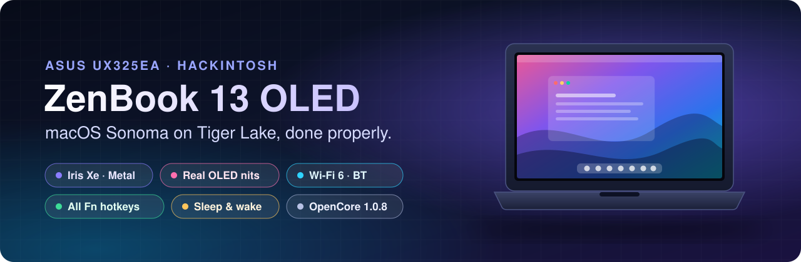
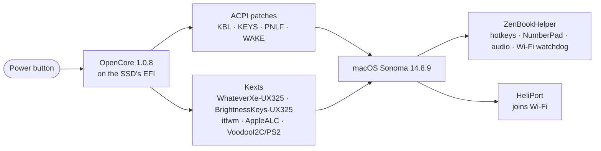

<div align="center">



<br>

[](#-software)
[](https://github.com/acidanthera/OpenCorePkg)
[](#-hardware)
[](#-whats-working)
[](#-whats-working)
[](https://github.com/AS2812/ZenBook-UX325EA-Hackintosh/stargazers)

**OpenCore EFI, ACPI patches, patched drivers and a small helper app that turn the ASUS ZenBook 13 OLED (UX325EA)<br>into a dependable macOS Sonoma laptop — with full Iris Xe Metal acceleration and real OLED brightness.**

[Highlights](#-highlights) · [What works](#-whats-working) · [Quick start](#-quick-start) · [Toolkit](#-toolkit) · [Troubleshooting](#-troubleshooting) · [Deep dives](#-deep-dives) · [Changelog](CHANGELOG.md)

⭐ **If this project helped you, please [star the repo](https://github.com/AS2812/ZenBook-UX325EA-Hackintosh/stargazers) — it helps other UX325EA owners find it.** ⭐

</div>

---

> [!IMPORTANT]
> **Generate your own SMBIOS before the first boot.** Serial, MLB, UUID and ROM in every `config*.plist` are
> placeholders (`W00000000001`, …). Use [GenSMBIOS](https://github.com/corpnewt/GenSMBIOS) or `macserial`
> with model `MacBookPro16,2`, otherwise Apple ID and iMessage will not work.

> [!WARNING]
> **Keep automatic macOS updates off.** The patched graphics driver is built for Sonoma **14.8.9 (23J631)**.
> System Settings → General → Software Update → ⓘ → turn off *Install macOS updates*.

## ✨ Highlights

<table>
<tr>
<td width="50%" valign="top">

### 🖥️ Iris Xe, fully accelerated
Apple's Tiger Lake framebuffer left the internal OLED **black** the moment it loaded. A patched
[WhateverXe](https://github.com/b00t0x/WhateverXe) fixes the eDP link setup — Metal, 1920×1080 at
60 Hz, 30-bit colour, clean boot and login screens.
<br>→ [How the black screen was fixed](docs/IRIS-XE-BLACK-SCREEN-FIX.md)

</td>
<td width="50%" valign="top">

### 🔆 Real OLED brightness
An OLED has no backlight, so the usual PWM path does nothing. The driver patch talks to the panel
over DPCD in **nits** (up to 616), so the Control Centre slider, the keys and the bezel all work —
and 0 really is black.
<br>→ [Brightness, keys and sleep](docs/OLED-BRIGHTNESS-KEYS-SLEEP.md)

</td>
</tr>
<tr>
<td width="50%" valign="top">

### ⌨️ Every hotkey, even after the lid
Volume, mute, brightness and the keyboard light work from boot **and after every lid wake**,
when the embedded controller reports them as plain F-keys. The Delete key next to the power
button moves files to the Trash, like on Windows.

</td>
<td width="50%" valign="top">

### 📶 Wi-Fi that survives sleep
The Intel AX201 runs on **itlwm + HeliPort**. No idle sleep two minutes after opening the lid,
a recovery agent that restarts the radio if the network list stays empty after a wake, and a
one-click speed test that shows the band, channel and signal.
<br>→ [The Wi-Fi investigation](docs/WIFI.md)

</td>
</tr>
</table>

## 🧩 Hardware

| | |
|---|---|
| **Model** | ASUS ZenBook 13 OLED **UX325EA** |
| **CPU** | Intel Core i7-1165G7 (Tiger Lake, 4 cores / 8 threads) |
| **GPU** | Intel Iris Xe Graphics (0x9A49, 96 EU) |
| **Display** | 13.3″ Samsung OLED 1920×1080 (ATNA33XC11), eDP 2 lanes |
| **Memory / storage** | 16 GB · 1 TB SK hynix PC711 NVMe |
| **Wireless** | Intel Wi-Fi 6 AX201 + Bluetooth |
| **Audio** | Realtek ALC294 |
| **Input** | PS/2 keyboard (ASUS ATK hotkeys) · ELAN I2C trackpad with NumberPad |

## ✅ What's working

| Area | Status | How |
|---|:---:|---|
| Graphics acceleration | ✅ | WhateverXe 0.8.3 + UX325EA patch v4.6, WhateverXe Graphics 0.4.4 |
| OLED brightness (slider, keys, 0 = black) | ✅ | DPCD nits interface, `SSDT-PNLF` (`_UID` 19) |
| Fn hotkeys, also after lid wake | ✅ | AsusSMC, BrightnessKeys-UX325, `SSDT-KBL`, `SSDT-KEYS`, `SSDT-WAKE` |
| Keyboard backlight (Fn+F7, 4 levels) | ✅ | `SSDT-KBL` |
| Trackpad gestures, two-finger menu, NumberPad | ✅ | VoodooI2C/HID + ZenBookHelper |
| Wi-Fi 6 | ✅ | itlwm 2.3.0 + HeliPort 1.5.0 (`wifi-driver.sh` switches to AirportItlwm) |
| Bluetooth | ✅ | IntelBluetoothFirmware + BlueToolFixup, USB map |
| Speakers, headphones, mute | ✅ | AppleALC `alcid=66`, amplifier re-enabled at start-up and after wake |
| Sleep & wake (lid and power button) | ✅ | `SSDT-WAKE`, ZenBookHelper, sleep settings from `fix-wifi.sh` |
| Shut down (black screen, clean power-off) | ✅ | panel off before power-off (driver v4.4) |
| Webcam · battery · NVMe · Apple ID / iCloud | ✅ | USB map · SMCBatteryManager + ECEnabler · PC711Probe · own SMBIOS |
| SD card reader | ⚠️ | driver loaded, not tested |
| External HDMI / USB-C display | ⚠️ | not tested |
| Built-in microphone | ❌ | digital mic on Intel's audio DSP — no macOS driver (use headset, Bluetooth or USB) |
| AirDrop / Continuity over Wi-Fi | ❌ | needs Apple's AWDL — not possible with any Intel Wi-Fi card |
| Wi-Fi-based location | ❌ / ⚠️ | not with itlwm; available with AirportItlwm (less stable on this laptop) |
| Windows Hello IR camera · Thunderbolt hot-plug of PCIe devices | ❌ | not supported on macOS |

### 📊 Performance

Measured on the laptop with the daily profile (on the charger):

| CPU busy | Memory pressure | Swap | Thermal | CPU speed limit |
|:---:|:---:|:---:|:---:|:---:|
| 5–20 % (peaks 40 %) | normal | 0 MB | nominal | 100 % |

The daily profiles do not load DebugEnhancer and drop `-dbgenhdbg`, so the kernel logs less.
H.264 and HEVC are decoded in hardware; YouTube's VP9/AV1 are decoded by the CPU, as on Intel Macs.

## 🔄 How it fits together



## 🚀 Quick start

> [!TIP]
> The USB stick is the **test bench**, the SSD is the **daily setup**. Try every change from the USB first,
> then copy it to the SSD with one command.

1. **Prepare the USB** — create a Sonoma 14.8.9 installer, copy `EFI/` to its EFI partition and `usb-kit/` to its data partition.
2. **Add your SMBIOS** (`MacBookPro16,2`) to `PlatformInfo › Generic` of every `config*.plist`.
3. **BIOS** (F2) — Secure Boot off, Fast Boot off, SATA mode AHCI.
4. **First boot** — copy `config-stable.plist` over `config.plist` (no acceleration), install macOS.
5. **Apply the fixes** as your normal user, then allow *Input Monitoring* and *Accessibility* for ZenBookHelper:
   ```sh
   sh "/Volumes/<USB>/fix-hardware.sh"
   ```
6. **Graphics acceleration** — put **WhateverXe Graphics 0.4.4** ([releases](https://github.com/b00t0x/WhateverXe/releases)) into `usb-kit/UX325EA-RESCUE/GPU/`, run `sh fix-hardware.sh --gpu-test` and restart. A one-boot guard falls back to the safe profile by itself if the screen stays black.
7. **Wi-Fi** — put **HeliPort** ([releases](https://github.com/OpenIntelWireless/HeliPort/releases)) into `usb-kit/`, then:
   ```sh
   sudo sh "/Volumes/<USB>/wifi-driver.sh" itlwm
   sudo sh "/Volumes/<USB>/fix-wifi.sh"
   ```
8. **Test, then make it permanent** — `sh fix-hardware.sh --test` guides you through every check. When it says **EVERYTHING WORKS**:
   ```sh
   sudo sh "/Volumes/<USB>/sync-efi-to-ssd.sh" --launcher-full
   ```
   Unplug the USB and power on: straight into macOS. Hold **Option (Alt)** at power-on for the boot menu.

<details>
<summary><b>Optional: macOS only — give macOS the whole SSD</b></summary>

<br>

Deletes Windows and **all its files**, grows the macOS APFS container over the whole SSD (live,
FileVault stays on), copies OpenCore to the SSD with the menu off and removes Windows Boot Manager.

```sh
sudo sh "/Volumes/<USB>/make-mac-only.sh"            # check only, changes nothing
sudo sh "/Volumes/<USB>/make-mac-only.sh" --apply    # asks you to type ERASE WINDOWS
```

It refuses — and changes nothing — when a Windows partition sits *before* macOS, because APFS can
only grow forwards. On the UX325EA: 341.5 GB → 1024 GB.

</details>

> [!CAUTION]
> Always **Eject** the USB before unplugging it — an unclean unplug can damage its data partition.

## 🧰 Toolkit

Everything in [`usb-kit/`](usb-kit) runs from the USB's data partition.

| Tool | What it does |
|---|---|
| `fix-hardware.sh` | applies every fix · `--test` guided test with report · `--audit` · `--diagnose` · `--gpu-*` profiles |
| `sync-efi-to-ssd.sh` | copies the tested EFI to the internal SSD, verified byte for byte, never touches `\EFI\Microsoft` |
| `make-mac-only.sh` | removes Windows and gives macOS the whole SSD (check mode by default) |
| `wifi-driver.sh` | switches **itlwm + HeliPort** ⇄ **AirportItlwm** on the SSD's and the USB's EFI, with backups |
| `fix-wifi.sh` | **one command for Wi-Fi**: installs the Wi-Fi package, gives the Intel card a working network service (clears HeliPort's "!"), hides the unusable macOS Wi-Fi icon, sleep timers, optional lid check |
| `wifi-log.sh` | Wi-Fi recorder: a line every 5 s and every outage with its time since the wake, through any number of lid sleeps, until you press Enter |
| `zenbook-status.sh` | read-only report: Wi-Fi driver and debug flags on the SSD, helper, Wi-Fi, CPU and memory |
| `Install ZenBook Wi-Fi.pkg` | itlwm + HeliPort, Wi-Fi recovery agent and **ZenBook Wi-Fi Repair** (speed test, report, reconnect) — source in `src/WiFiRecovery` |
| `ZenBookHelper.app` | power button, mute, NumberPad, speaker amplifier, Delete key, Wi-Fi watchdog (`wifiprobe`) |
| `GPU-OFF.command` | emergency rollback to the safe graphics profile from another Mac |

<details>
<summary><b>Repository layout</b></summary>

<br>

```text
EFI/OC/
├── config.plist            daily profile — acceleration + every fix (OpenCore menu shown on the USB)
├── config-gpu.plist        the same, used by the GPU guard
├── config-stable.plist     safe profile — same fixes, no acceleration, verbose boot
├── ACPI/                   SSDT-KBL · SSDT-KEYS · SSDT-PNLF · SSDT-WAKE · …
└── Kexts/
    ├── WhateverXe-UX325-v4.kext      patched WhateverXe          (src/WhateverXe-UX325)
    ├── BrightnessKeys-UX325.kext     volume/mute codes + EC poll (src/BrightnessKeys-UX325)
    └── USBMap-UX325EA.kext           Bluetooth (HS10) + webcam (HS06) internal
usb-kit/                    tools for the USB's data partition (see Toolkit)
src/                        ACPI sources, driver patches + test harnesses, helper source, USB map
docs/                       root-cause write-ups
```

</details>

## 🛠️ Troubleshooting

<details>
<summary><b>The USB or SSD entry starts Windows instead of macOS</b></summary>

<br>

When the battery runs completely flat, the ASUS BIOS loads its defaults: **Secure Boot is on
again** and the firmware silently skips OpenCore. Press **F2**, set *Secure Boot Control* and
*Fast Boot* to **Disabled**, fix the date and time, then **F10**. If OpenCore still starts the
wrong system, the saved startup disk was lost — pick macOS in the OpenCore menu, then
System Settings → General → Startup Disk → macOS → Restart.

</details>

<details>
<summary><b>Wi-Fi drops after closing the lid</b></summary>

<br>

Run `sudo sh "/Volumes/<USB>/fix-wifi.sh"` once: it installs the Wi-Fi package, stops the
battery idle sleep that switched Wi-Fi off two minutes after the lid was opened and offers a
hands-off lid check. The package's recovery agent restarts the radio if the network list stays
empty for a minute; **ZenBook Wi-Fi Repair → Show Report** saves the wake history.
Keep **Auto Join** in HeliPort only on your home network: HeliPort joins the first saved network
it sees, even a weak one that then drops after about a minute.
Details in [docs/WIFI.md](docs/WIFI.md).

</details>

<details>
<summary><b>A "!" on the Wi-Fi icons</b></summary>

<br>

- **HeliPort "!"** — HeliPort is joined to the router, but macOS has no internet path on the
  Intel card: no network service, no IP address or no DNS. Typical after switching from
  AirportItlwm, whose old "Wi-Fi" service does not apply to itlwm's Ethernet-type interface.
- **macOS Wi-Fi icon "!"** — with itlwm macOS sees no Wi-Fi card at all, so this icon can never
  work. HeliPort is the Wi-Fi menu.

`sudo sh "/Volumes/<USB>/fix-wifi.sh"` gives the card its own DHCP service "Intel Wi-Fi" (first in
the order), renews the address, falls back to public DNS only if the router's DNS fails, hides
the macOS icon and then runs HeliPort's own reachability check. `wifi-driver.sh airport`
brings the macOS icon back.

</details>

<details>
<summary><b>Black screen after a graphics change</b></summary>

<br>

Start from the USB and run `sh fix-hardware.sh --gpu-off`, or double-click `GPU-OFF.command`
on the USB from another Mac. The safe profile boots without acceleration.

</details>

<details>
<summary><b>Something is slow</b></summary>

<br>

Run `sudo sh "/Volumes/<USB>/zenbook-status.sh"` — it saves a read-only report (drivers in use,
debug flags, CPU, memory, Wi-Fi) to the USB, ready to attach to an issue.

</details>

## 📚 Deep dives

- [**Iris Xe black screen**](docs/IRIS-XE-BLACK-SCREEN-FIX.md) — why Apple's Tiger Lake framebuffer left the OLED dark, and the eDP fix
- [**OLED brightness, keys and sleep**](docs/OLED-BRIGHTNESS-KEYS-SLEEP.md) — DPCD nits, ASUS ATK hotkeys and the embedded controller after wake
- [**Wi-Fi after sleep**](docs/WIFI.md) — idle sleep, AirportItlwm drops, the move to itlwm, the recovery agent and speed test
- [**Changelog**](CHANGELOG.md) — every version, what changed and why

## 💻 Software

OpenCore **1.0.8** · macOS **Sonoma 14.8.9 (23J631)** · `SecureBootModel=Disabled` · `DmgLoading=Any`.
Dual boot with Windows on the same SSD is supported; the sync script never touches `\EFI\Microsoft`.

## 🙏 Credits

| Project | Used for |
|---|---|
| [OpenCore](https://github.com/acidanthera/OpenCorePkg), Lilu, VirtualSMC, AppleALC, RestrictEvents, FeatureUnlock, CpuTscSync, NVMeFix, BrightnessKeys, VoodooPS2 — **Acidanthera** | boot loader and core kexts |
| [WhateverXe](https://github.com/b00t0x/WhateverXe), AMFIAnchor — **b00t0x** | Iris Xe framebuffer (BSD-3-Clause, see `src/WhateverXe-UX325/LICENSE-WhateverXe.txt`) |
| [itlwm, AirportItlwm, HeliPort, IntelBluetoothFirmware](https://github.com/OpenIntelWireless) — **OpenIntelWireless** | Wi-Fi and Bluetooth |
| [VoodooI2C](https://github.com/VoodooI2C/VoodooI2C) | trackpad |
| AsusSMC, ECEnabler, RealtekCardReader, PC711Probe | ASUS hotkeys, battery, card reader, NVMe |
| [Dortania guides](https://dortania.github.io/OpenCore-Install-Guide/) | the foundation of every OpenCore build |

---

<div align="center">

### ⭐ Found this useful? Please star the repo!

It takes one click, keeps the project going and helps other ZenBook owners find a working setup.

[](https://github.com/AS2812/ZenBook-UX325EA-Hackintosh/stargazers)

<sub>Third-party kexts and drivers keep their own licenses. Not affiliated with Apple, ASUS or Intel. Use at your own risk.</sub>

</div>
